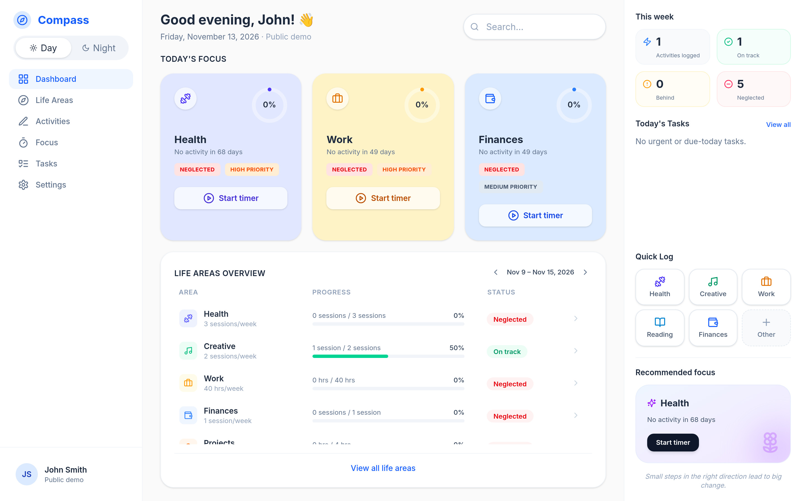
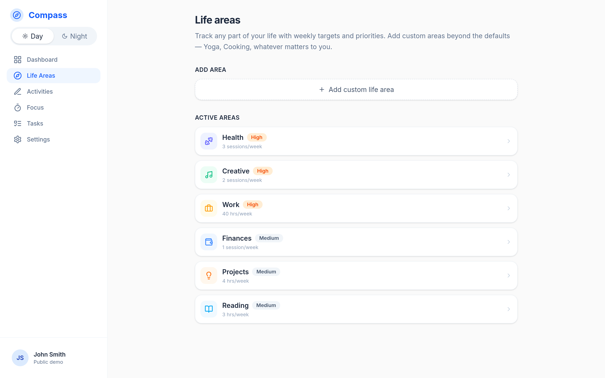
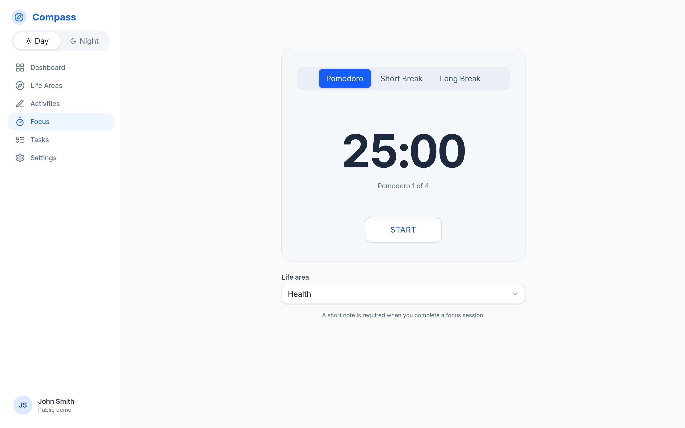
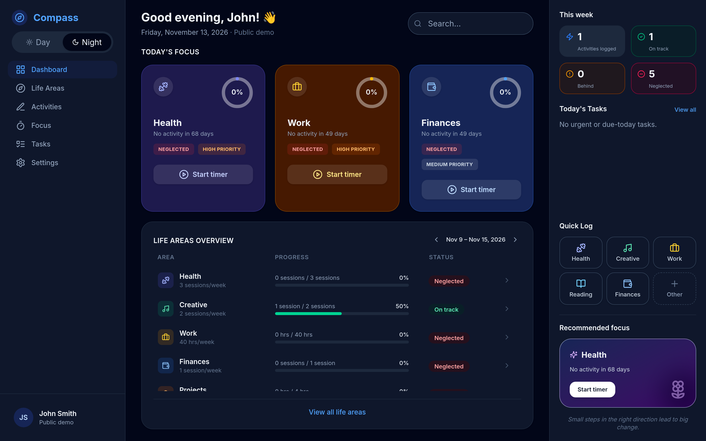
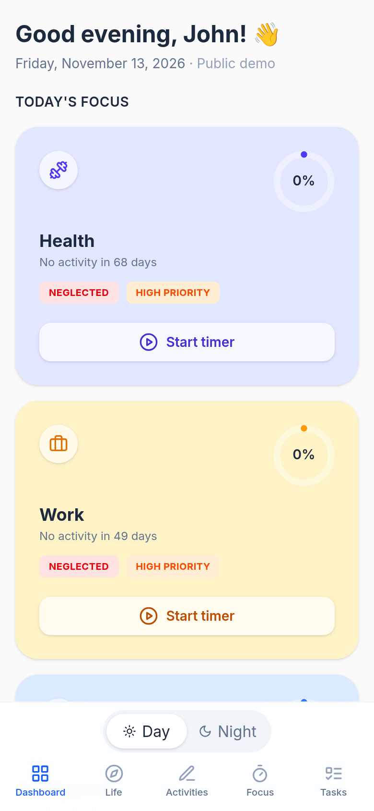

# Compass

A personal focus and life-balance app. It shows which parts of your week need attention, not only which tasks are left.

**[Live demo](https://compass-demo-tau.vercel.app)** — no sign-in; opens as the sample user John Smith.



## Features

- **Life areas** — weekly targets and priorities; add custom areas
- **Activity logging** — log time by area, date, duration, and a note
- **Focus timer** — Pomodoro flow (25/5/15) tied to one life area, with breaks, an alarm, and auto-log on complete
- **Dashboard** — Today's Focus, area overview, weekly stats, and a right-hand panel on desktop
- **Balance signals** — neglected, behind, on track, or over-focused

<p align="center">
  
  
</p>
<p align="center">
  
  
</p>

## Tech stack

Next.js 15, React 19, TypeScript, Prisma, NextAuth, and Tailwind CSS v4.

## Design

Colors and shell layout use CSS custom properties, with a per-area palette for cards, progress rings, and bars. Theme can be light, dark, or system, applied before first paint. The Day/Night toggle is a labeled group with pressed state for assistive tech.

<details>
<summary>Run locally</summary>

Requires Node.js 18+ and a PostgreSQL database. The project is set up for Neon.

1. Copy `.env.example` to `.env` and set `DATABASE_URL` (pooled), `DIRECT_URL`, `AUTH_SECRET`, `AUTH_EMAIL`, and `AUTH_PASSWORD`.
2. Install and start:

```bash
npm install
npm run db:migrate:deploy
npm run db:seed
npm run dev
```

Open [http://localhost:3000](http://localhost:3000).

To run a public demo, use a separate Neon database named `compass_demo` and the demo auth values from `.env.example`. Then run `npm run db:migrate:deploy` and `npm run db:seed:demo`. The demo seed will not run unless those are set; it replaces the sample logs and tasks so the week stays current.

</details>

## License

[MIT](./LICENSE)
